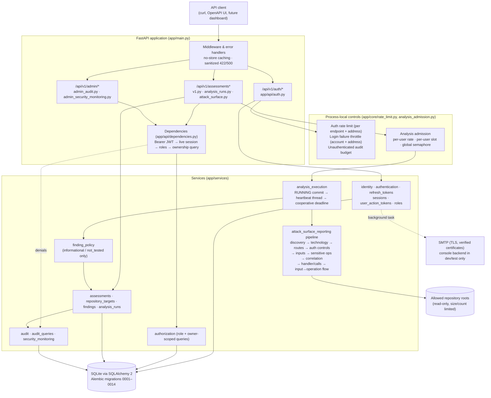

# AI Security Analyst — Backend

Backend API for **AI Security Analyst**, an evidence-driven, defensive security
assessment platform. This repository contains the FastAPI backend: identity and
session management, role- and ownership-based authorization, auditable assessment
workflows, and a deterministic static analysis pipeline that inventories a local
repository, maps its attack surface, traces input-to-operation flows, and records
conservative, evidence-backed findings.

> **Scope of this release.** The backend performs **deterministic** analysis: static
> analysis of repositories on the server's filesystem (secrets, dependencies, data
> flows) and, for explicitly authorized web targets, a safe crawler and opt-in
> read-only XSS/SQLi probes. Optional, advisory LLM explanations of existing findings
> can be enabled (off by default); AI never detects or classifies findings. Bounded,
> approval-gated workflows orchestrate these checks, and explanations are grounded
> in a curated, local knowledge base. JSON and self-contained HTML reports are
> generated from persisted results. It does **not** perform autonomous AI scanning or
> provide a dashboard. Those are planned and listed under
> [Roadmap](#17-future-development-roadmap).

Detailed per-subsystem behaviour (exact error bodies, concurrency rules, analyzer
internals) lives in [`docs/TECHNICAL_REFERENCE.md`](docs/TECHNICAL_REFERENCE.md).
Architecture decisions are recorded in [`docs/adr/`](docs/adr/), and the milestone
reports for the security-engine expansion are in [`docs/milestones/`](docs/milestones/).
The audit and release evidence for this version is in
[`FINAL_PROJECT_RELEASE_REPORT.md`](FINAL_PROJECT_RELEASE_REPORT.md).

## Contents

1. [Project overview](#1-project-overview)
2. [Problem statement](#2-problem-statement)
3. [Architecture](#3-architecture)
4. [Technology stack](#4-technology-stack)
5. [Implemented features](#5-implemented-features)
6. [Security design](#6-security-design)
7. [Repository-analysis workflow](#7-repository-analysis-workflow)
8. [Evidence and finding model](#8-evidence-and-finding-model)
9. [Authentication and authorization](#9-authentication-and-authorization)
10. [Database architecture and migrations](#10-database-architecture-and-migrations)
11. [Installation (Windows)](#11-installation-windows)
12. [Environment configuration](#12-environment-configuration)
13. [Running the application](#13-running-the-application)
14. [Running tests](#14-running-tests)
15. [API documentation](#15-api-documentation)
16. [Known limitations](#16-known-limitations)
17. [Future development roadmap](#17-future-development-roadmap)

## 1. Project overview

AI Security Analyst is an academic major project in AI-assisted defensive
cybersecurity. Its long-term goal is a platform that combines deterministic security
analysis, controlled runtime testing, evidence correlation, and AI-assisted
explanation into one assessment workflow.

This backend implements the foundation of that platform:

- A secure multi-user API (registration, email verification, login, refresh-token
  rotation, logout, password reset) with database-backed sessions.
- Assessments owned by users, with an audited status lifecycle.
- Registration of local repository targets confined to configured server directories.
- A static analysis pipeline: file discovery → technology detection → route
  extraction → authentication-control, input-source, and sensitive-operation
  detection → correlation → handler/call graph → input-to-operation flow analysis.
- Persisted analysis runs whose findings are conservative, evidence-backed, and
  explicitly marked as not runtime-verified.
- Durable audit events and administrator-only audit and denial-pattern APIs.

## 2. Problem statement

Web application security assessment usually spans source review, dependency
analysis, scanning, runtime testing, evidence collection, and reporting across many
tools with heavy manual interpretation. Automated scanners often produce findings
without context, and a suspicious code pattern does not by itself prove an
exploitable vulnerability.

This project's principle is that **findings must be grounded in recorded evidence
and labelled with how far they were verified**. The backend therefore never invents
severity or exploitability: static findings are reported as `informational` with
status `not_tested`, together with the source locations that support them.

## 3. Architecture



Layering rules: routes translate HTTP to service calls and map service exceptions
to status codes; services own their transaction boundaries; authorization is
expressed as database queries, never as client-supplied ownership. Route handlers
that do blocking work (Argon2 hashing, synchronous SQLAlchemy) are plain `def`
functions so FastAPI runs them in its threadpool instead of on the event loop.

## 4. Technology stack

| Area | Technology |
| ---- | ---------- |
| Language | Python 3.11+ |
| Web framework and validation | FastAPI, Pydantic v2, pydantic-settings |
| Persistence | SQLAlchemy 2.x, Alembic, SQLite (the only supported and tested runtime database) |
| Security primitives | Argon2id via `pwdlib[argon2]`, HS256 JWT via PyJWT, `secrets`-generated opaque tokens stored as SHA-256 digests |
| Dependency analysis | `packaging` (PEP 440/508), `tomllib`, `json`; OSV advisory API |
| Outbound HTTP | Standard-library `http.client`/`ssl` behind the guarded egress client |
| Static analysis | Python `ast`, a scoped JavaScript/TypeScript token scanner, `json`/`tomllib`/`xml.etree` manifest parsers |
| Email | Python standard library `smtplib` + `ssl` |
| Server | Uvicorn |
| Quality | pytest, httpx (ASGI test client), Ruff (lint and format) |

Optional extras: the official `anthropic` SDK (`pip install ".[ai]"`) for
advisory explanations (M9), which also drives the DeepSeek provider via its
Anthropic-compatible endpoint (ADR-0020); `psycopg` 3 (`.[postgres]`) for PostgreSQL (M13,
verified on PostgreSQL 16); and `langgraph` (`.[orchestration]`) for the
LangGraph workflow engine (M14, verified on langgraph 0.2.76). Not used: FAISS,
React, Docker.

## 5. Implemented features

### Implemented and tested

| Capability | Where |
| ---------- | ----- |
| Registration, email verification, verification resend, password reset with all-session revocation | `app/services/identity.py`, `app/api/auth.py` |
| Login with database-backed sessions; refresh-token rotation with replay detection; logout; `GET /me` | `authentication.py`, `refresh_tokens.py`, `sessions.py` |
| Role (Admin / Security Analyst / Viewer) and ownership authorization on every assessment route | `authorization.py`, `app/api/dependencies.py` |
| Auth rate limiting, failed-login throttling, bounded unauthenticated audit writes | `app/core/rate_limit.py` |
| Assessments with an audited `queued → running → completed/failed` lifecycle | `assessments.py` |
| Local repository targets confined to `REPOSITORY_ALLOWED_ROOTS` (symlink/traversal safe) | `repository_targets.py` |
| Deterministic repository discovery and technology detection | `repository_discovery.py`, `technology_detector.py` |
| Route extraction for FastAPI, Flask, Django, Express, NestJS | `attack_surface.py` |
| Authentication-control, input-source, and sensitive-operation detection | `auth_controls.py`, `input_sources.py`, `sensitive_operations.py` |
| Route/evidence correlation, handler and local call graph, input-to-operation flow | `attack_surface_correlation.py`, `handler_calls.py`, `input_operation_flow.py` |
| Attack-surface summary endpoint (repository-relative paths only) | `attack_surface_summary.py`, `app/api/attack_surface.py` |
| Analysis runs: atomic completion, sanitized failures, single active run per assessment, heartbeat lease, cooperative deadline, admission control | `analysis_execution.py`, `analysis_heartbeat.py`, `analysis_admission.py` |
| Durable background execution (opt-in `?mode=async`): queued runs claimed by `python -m app.worker` with a lease, stage progress, cancellation (`POST …/cancel`), stale-lease recovery, bounded retries of transient failures, stored summary (`?source=persisted`) (M8, ADR-0011) | `app/services/analysis_worker.py`, `app/worker.py` |
| Optional, advisory LLM explanations of findings (off by default): redacted minimum-necessary input, injection-safe prompt, schema-validated and evidence-grounded output, stored with provenance; failures never touch findings (M9, ADR-0012) | `app/services/explanations/`, `app/api/explanations.py` |
| PostgreSQL support: all migrations verified (round trip, no drift), full suite passes on PostgreSQL 16, exact worker cap via advisory lock and `FOR UPDATE SKIP LOCKED` (M13, ADR-0016) | `app/services/analysis_worker.py`, `tests/conftest.py` |
| JSON and HTML assessment reports from persisted data: deterministic schema with content hash, incomplete checks shown, AI explanations labelled, escaped HTML with hash-pinned CSP and no remote assets, assessment authorization (M12, ADR-0015) | `app/services/reports/`, `app/api/reports.py` |
| Curated, local knowledge retrieval for explanations: versioned, attributed, secret-checked guidance corpus (10 project documents plus optional operator corpus), BM25 or local-embedding retrieval with category/CWE/freshness filters and fallback, cited `kb:` IDs validated (M11, ADR-0014) | `app/knowledge/`, `app/services/knowledge/`, `app/api/knowledge.py` |
| Bounded assessment workflows: fixed allowlisted graph, deterministic check planner, human approval before active runtime probes, step/attempt budgets, persisted state and event log, resume and adoption after interruption (M10, ADR-0013) | `app/services/workflow/`, `app/api/workflows.py` |
| Authenticated local lab targets (DVWA): one scripted login with known credentials against an authorized loopback lab, session cookie stored (never the password, never exposed), authenticated crawl/probe, off by default and production-forbidden, opt-in integration test (M15/D14, ADR-0018) | `app/services/net/lab_session.py`, `app/services/lab_credentials.py`, `app/api/lab_credentials.py`, `docs/lab/dvwa.md` |
| Selectable orchestration engine: `WORKFLOW_ENGINE=builtin` (default, in-process) or `langgraph` (a real LangGraph `StateGraph` over the same nodes); both share one step function, so security and persistence are identical; LangGraph is optional, offline, and cannot bypass any control (M14, ADR-0017) | `app/services/workflow/langgraph_engine.py` |
| Conservative finding generation and normalized finding/evidence persistence | `finding_policy.py`, `findings.py` |
| Normalized evidence store (`evidence_items`, finding↔evidence links); every new finding has ≥1 evidence reference, a rule, source stage, verification method, and status rationale; cross-run identity with first/last seen, previous status, and `not_reproduced` retest results (M7) | `app/services/finding_normalization.py`, `app/services/findings.py` |
| Opt-in runtime XSS and SQL injection probes on crawled GET parameters: inert markers, read-only `AND` true/false pairs, documented proof rules (SQLi `confirmed` only by repeated boolean differentials; XSS never beyond `potential`) (M6) | `app/services/runtime_probes/` |
| Safe web crawler for authorized `web_security` targets: GET-only, same-origin and base-path scope, never submits forms, skips state-changing links, depth/page/request/variant budgets, robots.txt, page/form/auth-boundary inventory without values (M5) | `app/services/crawler/` |
| Explicit target authorization: owned, audited `assessment_targets` records; web targets need an allowlisted host plus a written authorization statement; revocation; analysis refused for unauthorized targets; per-user repository isolation (M4) | `app/services/target_authorization.py`, `app/api/targets.py` |
| Dependency inventory (requirements, pyproject, Poetry/Pipfile locks, npm manifests and lock files) and OSV advisory matching with local range verification, freshness-labelled cache, offline mode (M3) | `app/services/dependencies/` |
| Guarded egress HTTP client: host allowlist, DNS vetting with connect-to-vetted-IP (anti-rebinding), per-hop redirect revalidation, size/decompression/time/rate limits (M3) | `app/services/net/` |
| Offline secret scanning in analysis runs: versioned rule catalog, redacted excerpts, HMAC fingerprints, `potential` findings, narrow audited allowlist, custom rules (M2) | `app/services/secret_scanning/`, `analysis_tools.py` |
| Durable audit events; admin audit query and denial-pattern monitoring APIs | `audit.py`, `audit_queries.py`, `security_monitoring.py` |
| Fail-closed staging/production configuration; production API docs off by default | `app/core/config.py`, `app/main.py` |

### Partially implemented

| Capability | State |
| ---------- | ----- |
| Repository ingestion | Server-local directories only. No Git URL cloning or archive upload. |
| Static security checks | Secret scanning (M2), dependency advisory matching (M3), sensitive operations, and input flows are implemented. Dependency checks cover PyPI and npm only and require exact (locked or pinned) versions (see limitations). |
| JavaScript/TypeScript analysis | Route extraction uses a scoped token scanner, not a parser; deeper analyses are Python-focused. |
| Findings | Generated findings are always `informational` / `not_tested`; confirmed/inconclusive classification needs runtime evidence that does not exist yet. |
| Reporting | JSON and HTML assessment reports from persisted data (M12). Not stored; identified by content hash. No PDF export. |
| Analysis execution | Synchronous by default. Asynchronous mode needs `ANALYSIS_ASYNC_ENABLED=true` and a running worker; the queue is the database (no broker). Cancellation is cooperative (stage boundaries and heartbeats). |
| Roles | Roles are enforced, but there is no role-management API or admin bootstrap command. |
| Tool extension seam (M1) | Typed tool/evidence contracts, a stage registry and executor, redaction helpers, and target/network policy interfaces (`app/schemas/tooling.py`, `app/services/tooling/`). Analysis runs use the registry for the secret scanner; the original static pipeline still runs directly until M7. Network policy is defined but not enforced yet (M4). See `docs/adr/`. |

### Planned or not implemented

A DVWA lab and its integration tests, browser-based XSS confirmation, POST-form
and authenticated testing, FAISS or remote embeddings (M11 retrieval is local and dependency-free; see ADR-0014),
the React dashboard, Docker/Compose deployment, and distributed rate limiting.

## 6. Security design

- **Secrets and credentials.** `JWT_SECRET` and `SMTP_PASSWORD` are `SecretStr` and
  never appear in representations or errors. Passwords use Argon2id. Email action
  tokens and refresh tokens are high-entropy opaque values; only SHA-256 digests are
  stored, and raw values travel only in the email body or the token response.
- **Fail-closed configuration.** Configuration is validated at import and at
  startup. Staging and production refuse a missing or weak JWT secret, the console
  email backend, SMTP without TLS, development defaults for `DATABASE_URL`,
  `SMTP_HOST`, `EMAIL_FROM`, and `REPOSITORY_ALLOWED_ROOTS`, a `localhost` sender
  domain, and relative repository roots. Interactive API docs are off in production
  unless explicitly enabled.
- **No information disclosure.** API responses never contain absolute server paths
  (repository locations and analysis evidence are repository-relative). Validation
  errors never echo submitted values. Repository-location rejections all return one
  identical message, so the API cannot be used to probe the server filesystem.
  Unexpected server errors return a generic body.
- **Anti-enumeration.** Registration, verification resend, and reset requests always
  return the same `202` body; all unusable logins return the same `401`; unknown
  logins still run a dummy Argon2 verification. (A small timing difference remains —
  see [limitations](#16-known-limitations).)
- **Abuse controls.** Per-endpoint, per-address auth rate limits; a per-(account,
  address) failed-login throttle that cannot be used to lock a user out from another
  address; per-account email cooldowns stored in the database; analysis admission
  control; and a bounded budget for audit rows created by unauthenticated requests.
  Limiter memory is bounded without ever evicting an active counter.
- **Proxy handling.** The application never trusts `X-Forwarded-For`/`Forwarded`.
  Behind a reverse proxy, run Uvicorn with `--forwarded-allow-ips=<proxy address>`.
- **Filesystem safety.** Repository locations are resolved (following symlinks and
  `..`) before a component-based containment check. Analyzers read only inventoried
  regular files, skip symlinks/reparse points, refuse `.env` and credential-like
  files, cap file sizes and counts, and never execute repository code, Git, shell
  commands, or network requests.
- **Secret handling.** The secret scanner reads `.env` and key files, but values never
  leave it: excerpts mask every candidate value on the line, only keyed HMAC
  fingerprints are stored, nothing is logged, and no provider is contacted to test a
  credential (ADR-0005).
- **Integrity and concurrency.** Conditional `UPDATE`s guard every single-use
  transition (token consumption, refresh rotation, lifecycle claims, run
  completion). A partial unique index allows only one running analysis per
  assessment. Session revocation follows one lock order shared by login, reset,
  refresh, and logout. Only the expected uniqueness races are treated as benign;
  other integrity failures are logged without driver detail.
- **Auditability.** Mutations and their audit rows commit atomically; denials are
  recorded separately with no foreign-key link that could reveal existence.
- **Ethical use.** Analyse only repositories you own or are explicitly authorized to
  assess. The backend contains no network scanning capability.

## 7. Repository-analysis workflow

1. An authenticated Security Analyst or Admin creates a `repository` assessment
   (`POST /api/v1/assessments`), which they then own.
2. While the assessment is `queued`, they register a server-local directory inside
   `REPOSITORY_ALLOWED_ROOTS` (with `per_user` isolation, inside their own
   `<root>/<user id>/`) via `POST …/repository`. This also creates the target's
   authorization record; analysis is refused if it is later revoked. The resolved absolute path is
   stored; responses show only the path relative to its allowed root.
3. `POST …/analysis-runs` passes admission control, revalidates the target, commits a
   `running` run plus an `analysis_run.started` audit event, starts a heartbeat
   thread, and executes the pipeline under a cooperative deadline:
   discovery → technology detection → route extraction → authentication controls →
   input sources → sensitive operations → correlation → handler/call graph →
   input-to-operation flow, followed by the registry-based secret scanner and
   dependency auditor over the same inventory.
4. The finding policy converts only resolved, source-backed flows into findings, and
   secret evidence is grouped by fingerprint into `potential` secret findings.
   Findings, the `completed` state, metadata, and the completion audit event commit
   in one transaction. Any failure rolls the findings back and records a sanitized
   `failed` run with its audit event.
5. Results are read through `GET …/analysis-runs`, `GET …/analysis-runs/{run_id}`,
   and `GET …/findings`. `GET …/attack-surface/summary` recomputes the consolidated
   route-level evidence view on demand; `?source=persisted` returns the copy stored
   by the newest completed run instead.

With `ANALYSIS_ASYNC_ENABLED=true`, `POST …/analysis-runs?mode=async` commits a
`queued` run and returns 202. A worker (`python -m app.worker`) claims it, validates
the target again, and runs step 3 onwards under a lease. Stale leases are recovered
(requeued or failed) and runs can be cancelled with `POST …/analysis-runs/{run_id}/cancel`
(ADR-0011).

## 8. Evidence and finding model

A **finding** (`assessment_findings`) has: `title`, `category`, `severity`
(`critical`, `high`, `medium`, `low`, `informational`, `unknown`), `status`
(`confirmed`, `not_reproduced`, `inconclusive`, `not_tested`), `confidence` (0–1),
`summary`, `affected_component`, `remediation`, an optional `analysis_run_id`, and an
ordered list of **evidence** records (`finding_evidence`: `description`, `source`, and
a JSON `details` object).

Static findings generated by the pipeline:

- are produced only from `resolved` input-to-operation relationships with
  source-backed propagation steps;
- are always `informational` with status `not_tested`, and state that runtime
  execution and exploitability were not verified;
- reference repository-relative source locations;
- never receive an invented severity, confidence, or remediation. Relationships that
  cannot be represented are recorded as bounded limitations in the run metadata.

Secret findings (category `secret`) are always `potential`: a credential-shaped value
is committed at the listed locations, but its validity was never tested. Severity
comes from the matching rule (for example `critical` for AWS secret keys and Stripe
live keys); evidence holds the rule ID, rule-set version, repository-relative
location, a masked excerpt, and an HMAC fingerprint.

Since M7 every finding also carries `rule_id`, `source_stage`,
`verification_method`, `status_rationale`, CWE/CVE identifiers, `first_seen_at`,
`last_seen_at`, `previous_status`, and `evidence_ids` that point to normalized,
redacted evidence items (`GET …/evidence/{id}`). Re-running an analysis marks issues
that are no longer observed as `not_reproduced`, but only when the check that found
them completed again.

These are leads for a human reviewer, not confirmed vulnerabilities.

## 9. Authentication and authorization

- **Accounts.** Public registration creates an unverified account with no role.
  Verifying the email grants `Security Analyst` only if the user has no role yet.
  `Viewer` and `Admin` are never granted automatically.
- **Login.** Returns a short-lived HS256 access token (`sub` = user, `sid` = session,
  no role claims) and an opaque refresh token. Unverified, inactive, unknown, and
  wrong-password logins share one `401`.
- **Every protected request** re-validates the JWT and loads the session row (must be
  unrevoked and within idle and absolute expiry), the user (active and verified), and
  the user's roles from the database.
- **Refresh rotation** consumes the presented token exactly once and issues a
  replacement; replaying a consumed token revokes the whole session family.
- **Logout** revokes the current session family. **Password reset** revokes every
  session of that user atomically with the password change.
- **Authorization.** Admins see every assessment; Security Analysts and Viewers see
  only assessments they own; only Admins and Security Analysts can create, mutate, or
  run analyses. Assessments the caller cannot see return `404`, the same as
  nonexistent ones. `/api/v1/admin/*` requires `Admin`.

See [`docs/TECHNICAL_REFERENCE.md`](docs/TECHNICAL_REFERENCE.md#authorization) for
lock ordering, token lifetimes, and the exact error contracts.

## 10. Database architecture and migrations

SQLite is accessed through SQLAlchemy 2 with foreign-key enforcement enabled on every
connection. All timestamps are timezone-aware UTC. The schema is created only by
Alembic; the application never creates tables at startup.

| Migration | Adds |
| --------- | ---- |
| `0001`–`0002` | `assessment_jobs`, `assessment_status_history` |
| `0003` | `repository_targets` (one per assessment) |
| `0004` | `assessment_findings`, `finding_evidence` |
| `0005`–`0007` | `analysis_runs`, run metadata, partial unique index (one `running` run per assessment) |
| `0008` | `users`, `roles` (three seeded roles with fixed UUIDs), `user_roles` |
| `0009` | `user_action_tokens` (hashed, single active token per user and purpose) |
| `0010` | `user_sessions`, `refresh_tokens` (one active refresh token per session) |
| `0011` | nullable `assessment_jobs.owner_id` (`ON DELETE RESTRICT`) |
| `0012` | `audit_events` |
| `0013` | terminal analysis-run audit actions |
| `0014` | run lease columns (`heartbeat_at`, `cancel_requested_at`, `cancel_requested_by_user_id`) |
| `0015` | `potential` finding status (downgrade refuses while `potential` rows exist) |
| `0016` | `assessment_targets` (ownership and authorization; backfilled from repository targets) and target audit actions |
| `0017` | `evidence_items`, `finding_evidence_links`, finding identity/retest columns (downgrade refuses while evidence exists) |
| `0018` | `queued`/`cancelled` run states, one queued-or-running run per assessment, lease/progress/retry columns, stored summary, queue/cancel audit actions (downgrade refuses while such rows exist) |
| `0019` | `finding_explanations` (advisory LLM explanations with provenance) and its audit values (downgrade refuses while explanations exist) |
| `0020` | `assessment_workflows` (one active per assessment) and `workflow_events`, workflow audit values (downgrade refuses while workflows exist) |
| `0021` | `finding_explanations.retrieval` (knowledge-base version and source IDs supplied) |
| `0022` | `web_target_lab_sessions` (one per assessment; stores only the lab session cookie) and lab-session audit actions (downgrade refuses while such rows exist) |

SQLite migrations use Alembic batch mode. `migrations/env.py` disables foreign-key
enforcement on migration connections (so table rebuilds cannot cascade-delete child
rows) and then re-enables it and runs `PRAGMA foreign_key_check` on a fresh
connection. Upgrade, downgrade, and data-preservation tests cover migrations
`0010`–`0017`. Upgrading to `0007` requires that no assessment has two `running` runs.

## 11. Installation (Windows)

Requirements: Python 3.11 or newer and Git. From PowerShell in the repository root:

```powershell
py -3.11 -m venv .venv
.\.venv\Scripts\Activate.ps1
python -m pip install --upgrade pip
pip install -e ".[dev]"
Copy-Item .env.example .env
```

If script execution is blocked, run
`Set-ExecutionPolicy -Scope CurrentUser RemoteSigned` once, or activate with
`.\.venv\Scripts\activate.bat` from `cmd.exe`.

macOS/Linux equivalent:

```bash
python3.11 -m venv .venv
source .venv/bin/activate
python -m pip install --upgrade pip
pip install -e ".[dev]"
cp .env.example .env
```

Create the directory that will hold repositories to analyse (the default allowed
root is `repositories` relative to the working directory) and apply migrations:

```powershell
New-Item -ItemType Directory -Force repositories
$env:APP_ENV = "development"
alembic upgrade head
```

## 12. Environment configuration

Settings come from environment variables, falling back to `.env`
(`app/core/config.py`). `.env.example` is the tracked template and contains no real
credentials. `APP_ENV` is required (`development`, `test`, `staging`, `production`).

| Variable | Default | Purpose |
| -------- | ------- | ------- |
| `APP_ENV` | — (required) | Selects validation strictness |
| `DATABASE_URL` | `sqlite:///./ai_security_analyst.db` | SQLAlchemy URL (must be explicit in staging/production) |
| `JWT_SECRET` | unset | ≥ 32 UTF-8 bytes; required in staging/production |
| `ACCESS_TOKEN_TTL_SECONDS` | `600` | Access-token lifetime (300–900) |
| `REFRESH_TOKEN_TTL_SECONDS` | `1209600` | Idle-session / refresh lifetime |
| `ABSOLUTE_SESSION_TTL_SECONDS` | `2592000` | Maximum session lifetime |
| `ARGON2_*` | time 3, memory 64 MiB, parallelism 4 | Password hashing cost |
| `EMAIL_BACKEND` | `smtp` | `console` allowed only in development/test |
| `EMAIL_FROM`, `SMTP_HOST`, `SMTP_PORT` | `no-reply@localhost`, `localhost`, `587` | Must be explicit in staging/production |
| `SMTP_STARTTLS` / `SMTP_SSL` | `true` / `false` | One must be enabled in staging/production |
| `SMTP_USERNAME`, `SMTP_PASSWORD` | unset | Optional credentials (password required with username) |
| `EMAIL_VERIFICATION_TOKEN_TTL_SECONDS`, `PASSWORD_RESET_TOKEN_TTL_SECONDS` | `86400`, `3600` | Action-token lifetimes |
| `AUTH_RATE_LIMIT_MAX_REQUESTS` / `_WINDOW_SECONDS` | `10` / `60` | Per endpoint and client address |
| `AUTH_TOKEN_REQUEST_COOLDOWN_SECONDS` | `60` | Per-account email cooldown (database-backed) |
| `AUTH_LOGIN_FAILURE_MAX_ATTEMPTS` / `_WINDOW_SECONDS` | `5` / `900` | Failed logins per (account, address) before `429` |
| `AUTH_LOGIN_ACCOUNT_ALERT_THRESHOLD` | `50` | Account-wide failures that log a security warning (never blocks) |
| `AUDIT_UNAUTHENTICATED_DENIALS_PER_CLIENT` / `_GLOBAL` / `_WINDOW_SECONDS` | `20` / `600` / `60` | Budget for audit rows from unauthenticated requests |
| `API_DOCS_ENABLED` | unset | Unset: docs on except in production |
| `EVIDENCE_FINGERPRINT_KEY` | unset | HMAC key (≥ 32 bytes) for secret fingerprints; required in staging/production |
| `SECRET_SCAN_ENABLED` | `true` | Run the secret scanner in analysis runs (disabled ⇒ reported as skipped) |
| `SECRET_SCAN_MAX_FILE_SIZE_BYTES` / `_MAX_TOTAL_BYTES` / `_MAX_FILES` / `_MAX_MATCHES` | 1 MiB / 64 MiB / 5000 / 1000 | Scanner budgets; exceeding one makes the result partial |
| `SECRET_SCAN_ALLOWLIST` | `[]` | JSON `{rule_id, path_glob, reason}` suppressions (narrow, counted, explained) |
| `SECRET_SCAN_CUSTOM_RULES` | `[]` | JSON `{rule_id: "custom.*", title, pattern, severity}` project rules |
| `REPOSITORY_ISOLATION` | `shared` | `per_user` confines owners to `<root>/<user id>/`; must be explicit in staging/production |
| `WEB_TARGET_ALLOWED_HOSTS` | `[]` | Hostnames that may be registered as web targets (empty = none) |
| `WEB_TARGET_ALLOWED_LOCAL_NETWORKS` | `[]` | Lab CIDRs (e.g. DVWA on loopback); refused in staging/production |
| `CRAWLER_MAX_DEPTH` / `_MAX_PAGES` / `_MAX_REQUESTS` / `_MAX_VARIANTS_PER_PATH` | `3` / `50` / `150` / `3` | Crawl budgets; reaching one makes the crawl partial |
| `CRAWLER_RESPECT_ROBOTS` / `CRAWLER_EXCLUDED_PATHS` | `true` / `[]` | robots.txt courtesy; path prefixes never requested |
| `WEB_TARGET_MAX_REQUESTS_PER_SECOND` | `2` | Request rate per web target (crawler and probes) |
| `RUNTIME_PROBES_ENABLED` | `false` | Enable XSS/SQLi probes (disabled ⇒ reported as skipped) |
| `RUNTIME_PROBE_MAX_PARAMETERS` / `_MAX_REQUESTS` | `10` / `200` | Probe budgets; exceeding one makes the result partial |
| `DEPENDENCY_AUDIT_MODE` | `online` | `online` (OSV via guarded client), `offline` (cache only), or `disabled` |
| `ADVISORY_OSV_BASE_URL` | `https://api.osv.dev` | Advisory API; must be https; its host is the only permitted egress |
| `ADVISORY_CACHE_DIR` / `ADVISORY_CACHE_TTL_SECONDS` | unset / `86400` | Optional file cache; expired entries are used only as labelled stale data |
| `ADVISORY_MAX_PACKAGES` / `ADVISORY_REQUEST_TIMEOUT_SECONDS` | `2000` / `20` | Per-run package budget; total time per advisory request |
| `DEPENDENCY_MANIFEST_MAX_SIZE_BYTES` | 10 MiB | Largest manifest or lock file parsed |
| `REPOSITORY_ALLOWED_ROOTS` | `["repositories"]` | JSON array; absolute paths required in staging/production |
| `REPOSITORY_MAX_FILE_COUNT` / `_MAX_DEPTH` / `_MAX_TOTAL_SIZE_BYTES` | `10000` / `50` / 512 MiB | Discovery limits |
| `*_MAX_SIZE_BYTES`, `*_MAX_SOURCE_FILES` | 1 MiB, 2000 | Per-analyzer read limits |
| `ANALYSIS_EXECUTION_TIMEOUT_SECONDS` | `300` | Cooperative run deadline |
| `ANALYSIS_HEARTBEAT_INTERVAL_SECONDS` / `ANALYSIS_STALE_AFTER_SECONDS` | `15` / `420` | Lease renewal; lease length and stale threshold used by worker recovery |
| `ANALYSIS_ASYNC_ENABLED` | `false` | Allow `?mode=async` (needs a running worker) |
| `ANALYSIS_WORKER_MAX_ATTEMPTS` / `_MAX_RUNNING` / `_POLL_INTERVAL_SECONDS` | `3` / `2` / `2` | Worker retries, deployment-wide running cap, idle poll |
| `LLM_EXPLANATIONS_ENABLED` / `LLM_API_KEY` | `false` / unset | Advisory explanations; the key is required in staging/production when enabled |
| `LLM_PROVIDER` / `LLM_BASE_URL` | `anthropic` / unset | `anthropic` or `deepseek`; `deepseek` reuses the `anthropic` SDK against its Anthropic-compatible endpoint `https://api.deepseek.com/anthropic` (ADR-0020) and requires `LLM_BASE_URL` |
| `LLM_MODEL` / `LLM_EFFORT` / `LLM_REFUSAL_FALLBACK` | `claude-opus-5-5` / `medium` / `true` | Provider model (use `deepseek-flash` for DeepSeek); reasoning effort and server-side refusal fallback apply to Anthropic only |
| `LLM_TIMEOUT_SECONDS` / `LLM_MAX_RETRIES` | `60` / `2` | Per attempt; wall clock up to timeout × (retries + 1) |
| `LLM_MAX_OUTPUT_TOKENS` / `LLM_ASSESSMENT_TOKEN_BUDGET` | `16000` / `500000` | Per-finding output cap; per-assessment total |
| `LLM_MAX_PROMPT_CHARS` / `LLM_MAX_EVIDENCE_ITEMS` / `LLM_MAX_RESPONSE_CHARS` | `24000` / `10` / `40000` | Input and output size bounds |
| `WORKFLOW_MAX_STEPS` / `WORKFLOW_MAX_NODE_ATTEMPTS` / `WORKFLOW_MAX_EXPLANATIONS` | `20` / `2` / `5` | Workflow step budget, retries per node, LLM calls per workflow |
| `WORKFLOW_ENGINE` | `builtin` | Orchestration engine: `builtin` or `langgraph` (needs the `[orchestration]` extra) |
| `WEB_AUTH_LAB_ENABLED` | `false` | Authenticate into an authorized local web lab (DVWA); dev/lab only, forbidden in staging/production |
| `WEB_AUTH_LAB_LOGIN_PATH` / `_CSRF_FIELD` / `_USERNAME_FIELD` / `_PASSWORD_FIELD` | `/login.php` / `user_token` / `username` / `password` | Lab login form shape (DVWA defaults) |
| `RAG_ENABLED` / `RAG_BACKEND` | `true` / `lexical` | Ground explanations in the local knowledge base; `vector` uses local hashing embeddings |
| `RAG_MAX_CHUNKS` / `RAG_MAX_CHUNK_CHARS` / `RAG_INCLUDE_STALE` | `4` / `900` / `false` | Retrieval size bounds; whether stale documents are used (labelled) |
| `RAG_CORPUS_DIR` | unset | Optional operator corpus (licensed, reviewed sources in the same format) |
| `REPORT_MAX_FINDINGS` / `REPORT_MAX_EVIDENCE_PER_FINDING` / `REPORT_MAX_BYTES` | `500` / `10` / `5000000` | Report size limits (omitted counts are shown; oversize returns 413) |
| `ANALYSIS_MAX_CONCURRENT_JOBS` / `_PER_USER` | `2` / `1` | Process-local concurrency |
| `ANALYSIS_QUEUE_WAIT_SECONDS` | `2` | Max wait for global capacity |
| `ANALYSIS_RATE_LIMIT_MAX_REQUESTS` / `_WINDOW_SECONDS` | `10` / `60` | Per user and scope |

Generate a secret with `python -c "import secrets; print(secrets.token_urlsafe(48))"`
and keep it in `.env` (ignored by Git) or a secret manager. Never commit real
secrets.

## 13. Running the application

```powershell
$env:APP_ENV = "development"
uvicorn app.main:app --reload
```

The API listens on <http://127.0.0.1:8000>; `GET /health` returns `{"status": "ok"}`.
With `EMAIL_BACKEND=console`, verification and reset tokens are printed to the
server console.

Typical first session (PowerShell):

```powershell
$base = "http://127.0.0.1:8000/api/v1"
Invoke-RestMethod -Method Post "$base/auth/register" -ContentType "application/json" `
  -Body '{"email":"analyst@example.com","password":"a long passphrase here"}'
# Copy the verify_... token from the server console:
Invoke-RestMethod -Method Post "$base/auth/verify-email" -ContentType "application/json" `
  -Body '{"token":"verify_..."}'
$login = Invoke-RestMethod -Method Post "$base/auth/login" -ContentType "application/json" `
  -Body '{"email":"analyst@example.com","password":"a long passphrase here"}'
$h = @{ Authorization = "Bearer $($login.access_token)" }
$a = Invoke-RestMethod -Method Post "$base/assessments" -Headers $h `
  -ContentType "application/json" -Body '{"assessment_type":"repository"}'
```

For production, run behind TLS termination with explicit settings, for example
`uvicorn app.main:app --host 0.0.0.0 --forwarded-allow-ips=<proxy address>`.
Multiple workers multiply the process-local limits (see limitations).

## 14. Running tests

```powershell
$env:APP_ENV = "test"
pytest
ruff check .
ruff format --check .
```

Each test creates a temporary SQLite database, applies all migrations, and uses
temporary repositories; no developer database or network access is used. The suite
covers identity, sessions, authorization, path containment, information-disclosure
regressions, rate limiting, configuration validation, migrations, concurrency
(file-backed SQLite with threads), and every analyzer. Seven tests are skipped on
non-Windows hosts because they exercise Windows-only path semantics.

Migration consistency check against a scratch database:

```powershell
$env:APP_ENV = "test"
$env:DATABASE_URL = "sqlite:///./scratch-check.db"
alembic upgrade head
alembic check
alembic downgrade base
alembic upgrade head
Remove-Item scratch-check.db
```

## 15. API documentation

Interactive documentation is served at `/docs` (Swagger UI), `/redoc`, and
`/openapi.json` outside production.

| Method | Path | Auth | Purpose |
| ------ | ---- | ---- | ------- |
| `POST` | `/api/v1/auth/register` | — | Register (generic `202`) |
| `POST` | `/api/v1/auth/resend-verification` | — | Re-send verification (generic `202`) |
| `POST` | `/api/v1/auth/verify-email` | — | Consume verification token (`204`) |
| `POST` | `/api/v1/auth/password-reset/request` | — | Request reset (generic `202`) |
| `POST` | `/api/v1/auth/password-reset/confirm` | — | Set new password, revoke sessions (`204`) |
| `POST` | `/api/v1/auth/login` | — | Access + refresh tokens |
| `POST` | `/api/v1/auth/refresh` | — | Rotate refresh token |
| `GET` | `/api/v1/auth/me` | Bearer | Current identity and roles |
| `POST` | `/api/v1/auth/logout` | Bearer | Revoke current session family (`204`) |
| `POST` | `/api/v1/assessments` | Analyst/Admin | Create owned assessment |
| `GET` | `/api/v1/assessments` | Any role | List visible assessments (`limit` ≤ 100) |
| `GET` | `/api/v1/assessments/{id}` | Any role | Read one |
| `PATCH` | `/api/v1/assessments/{id}/status` | Analyst/Admin | Lifecycle transition |
| `GET` | `/api/v1/assessments/{id}/history` | Any role | Status history |
| `POST` / `GET` | `/api/v1/assessments/{id}/repository` | Analyst/Admin / any role | Register / read repository target |
| `POST` | `/api/v1/assessments/{id}/web-target` | Analyst/Admin | Register an allowlisted web target with an authorization statement |
| `GET` | `/api/v1/assessments/{id}/targets` | Any role | Targets and their authorization state |
| `POST` | `/api/v1/assessments/{id}/targets/{target_id}/authorize` / `revoke` | Analyst/Admin | Re-authorize or revoke a target |
| `GET` | `/api/v1/assessments/{id}/findings` | Any role | Findings (optional `analysis_run_id`) |
| `GET` | `/api/v1/assessments/{id}/evidence[/{evidence_id}]` | Any role | Normalized evidence items |
| `POST` | `/api/v1/assessments/{id}/analysis-runs[?mode=async]` | Analyst/Admin | Run analysis synchronously (201), or queue it (202) |
| `POST` | `/api/v1/assessments/{id}/analysis-runs/{run_id}/cancel` | Analyst/Admin | Cancel a queued run / request cancellation of a running run |
| `POST` / `GET` | `/api/v1/assessments/{id}/findings/{finding_id}/explanations` | Analyst/Admin / any role | Request an advisory explanation / list attempts |
| `GET` | `/api/v1/knowledge`, `/api/v1/knowledge/search?q=&category=&cwe=` | Any role | Knowledge-base version and sources / attributed search |
| `GET` | `/api/v1/assessments/{id}/reports/json` \| `html` `[?analysis_run_id=]` | Any role with access | Download the assessment report |
| `POST` / `GET` / `DELETE` | `/api/v1/assessments/{id}/web-target/lab-credentials` | Analyst/Admin / any role / Analyst/Admin | Establish / inspect / clear an authenticated local-lab session (DVWA) |
| `POST` / `GET` | `/api/v1/assessments/{id}/workflows[/{workflow_id}]` | Analyst/Admin / any role | Start a bounded workflow / list or inspect (plan, approvals, events) |
| `POST` | `/api/v1/assessments/{id}/workflows/{workflow_id}/approvals` \| `resume` \| `cancel` | Analyst/Admin | Approve or deny a high-risk check; continue; cancel |
| `GET` | `/api/v1/assessments/{id}/analysis-runs[/{run_id}]` | Any role | Run history / detail |
| `GET` | `/api/v1/assessments/{id}/attack-surface/summary[?source=persisted]` | Any role | Recomputed summary, or the one stored by the latest completed run |
| `GET` | `/api/v1/admin/audit-events` | Admin | Filtered audit events |
| `GET` | `/api/v1/admin/security-monitoring/denial-patterns` | Admin | Denial aggregation |
| `GET` | `/health` | — | Liveness |

"Any role" means any of Admin, Security Analyst, or Viewer, restricted to visible
assessments. Exact request/response bodies and error codes are in
[`docs/TECHNICAL_REFERENCE.md`](docs/TECHNICAL_REFERENCE.md).

## 16. Known limitations

These are accepted, documented limitations of this release. None of them is
claimed as fixed.

**Infrastructure and scale**

- **SQLite only.** PostgreSQL code paths (row locks, partial indexes) exist but are
  not tested; no PostgreSQL driver is declared. Concurrency guarantees are verified
  only on file-backed SQLite. Supporting PostgreSQL needs a driver, a PostgreSQL CI
  service, and the migration and contention suites run against it.
- **Process-local limits.** Auth rate limits, the failed-login throttle, the
  unauthenticated audit budget, and analysis admission control are per process. With
  N workers or instances the effective limits are roughly N times the configured
  values. Deployment-wide enforcement needs a shared store (for example Redis) or
  gateway rate limiting.
- **Synchronous analysis by default.** Analysis runs (unless `?mode=async`), and every
  live attack-surface summary request, execute inside the HTTP request and occupy a
  worker thread. The deadline is checked
  between stages, so one long stage can overrun it. The summary endpoint re-runs the
  whole pipeline on every call, and analyzers re-read the same files.
- **Recovery needs a worker.** Stale runs are reclaimed only by the worker's recovery
  sweep (`python -m app.worker`, or `--recover-only` on a schedule). Without one, a
  crashed process still leaves its run `running` until recovery runs. Cancellation is
  cooperative, so a single long stage finishes before it stops. The queue is the
  database; the running cap is exact on SQLite and PostgreSQL (ADR-0011, ADR-0016).
- **No retention policies.** `audit_events`, `refresh_tokens`, `user_sessions`, and
  `user_action_tokens` grow without bound. A scheduled cleanup job is needed.

**Security (residual risks)**

- **S-7 — repository isolation is a deployment choice.** Fixed in M4 when
  `REPOSITORY_ISOLATION=per_user`: each owner can register and analyse only
  `<allowed root>/<owner id>/…`, checked at registration and at analysis time, and
  every target has an owned, audited authorization record. With the development
  default `shared`, all analysts still share the allowed roots. Staging and
  production must choose explicitly.
- **S-8 — enumeration timing.** For an existing account, password-reset and
  verification-resend requests do measurably more database work (about 2.0 ms vs
  1.1 ms median in-process). Response bodies are identical. Impact: a patient
  attacker on a low-jitter network could infer account existence statistically; rate
  limits and per-account cooldowns cap the sample rate. Deferred because a correct fix
  moves token issuance off the request path (a background job with its own session)
  rather than adding artificial delays.
- **S-10 — default-role check-then-insert.** The default role is granted only if the
  user has no role, using a read followed by an insert. No API can assign roles
  concurrently today, so it is not exploitable now. Once role management exists, an
  explicit assignment racing with email verification could leave both roles. A
  conditional insert or user-row lock must accompany any role-management API.
- **S-12 — logs.** Tokens, passwords, and token hashes are never logged, and new
  security warnings log only hashed or truncated identifiers. Unexpected analysis
  failures are logged with `logger.exception`, whose tracebacks can include server
  file paths. There is no structured logging configuration or redaction filter; logs
  must be treated as sensitive operational data.
- **No credential-stuffing block across many addresses.** Distributed guessing
  against one account is detected (an alert log) but not blocked, deliberately, to
  avoid an account-lockout denial of service. MFA or CAPTCHA would be required.
- **No admin bootstrap or role management.** The first Admin must be assigned in the
  database. A `Viewer` cannot see anything without a sharing model.
- **Refresh-reuse strictness.** A legitimate client that retries a refresh
  concurrently triggers reuse detection and loses its session family (no grace
  window).

**Secret scanning**

- Detection is regex-based and line-oriented. Secrets split across lines, encoded
  (for example base64 inside a config blob), or in formats outside the catalog are
  found only by the generic name-plus-entropy rule, or not at all.
- Binary files, lock files, vendored directories, and minified assets are not
  scanned (counted as policy exclusions). Git history is not scanned; only the
  working tree inventory is.
- Credential validity is never tested, so every secret finding is `potential`.
- Without `EVIDENCE_FINGERPRINT_KEY` (development only), fingerprints use a
  per-process key and cannot be compared across runs.

**Dependency analysis**

- Only PyPI and npm are supported; `pnpm-lock.yaml`, `yarn.lock`, and other
  ecosystems are reported as unsupported or ignored.
- Dependencies declared with ranges and no lock file are reported as unresolved
  and not checked.
- `confirmed` dependency findings mean the exact version is inside a published
  advisory's affected range. Reachability of the vulnerable code is not analysed.
- Severity uses the advisory's label only; CVSS vectors are not scored, so some
  findings have severity `unknown`.
- Online mode needs outbound HTTPS to `api.osv.dev`; without it, use offline mode
  with a populated `ADVISORY_CACHE_DIR`. Unchecked packages are always reported as
  unchecked, never as clean.

**Web crawling**

- Crawling inventories pages, parameters, forms, and authentication boundaries.
  Runtime probes (opt-in) test only GET parameters for reflected XSS and
  boolean-based SQL injection. POST forms, stored/DOM XSS, and time-based blind SQL
  injection are not tested, and XSS is never confirmed (no browser harness).
- The string-context SQL test uses the baseline value `1`; parameters where that
  value matches nothing cannot show a differential.
- No JavaScript execution and no authenticated crawling.
- The state-changing link denylist is pattern-based; unusual destructive GET
  endpoints with innocuous names could still be requested. Crawl only lab or
  disposable environments you are authorized to test.

**Evidence and correlation**

- Static findings and runtime findings are not yet correlated: repository and web
  targets belong to different assessments with no declared link between them.
- Findings persisted before migration 0017 have no normalized evidence links (their
  legacy evidence is unchanged).

**Functional scope**

- Runtime testing is limited to reflected XSS indicators and boolean SQLi on crawled
  GET parameters of authorized targets. There is no LangGraph library (M10 uses an
  in-house bounded graph), frontend, or container setup. LLM explanations are advisory, opt-in,
  and have been tested only against a fake provider, never a live one.
- Repository ingestion is server-local only; analysis depth is Python-centred.
- Windows installation steps are documented but this release was verified on macOS;
  Windows-specific path tests run only on Windows.

## 17. Future development roadmap

1. **Hardening (next).** Admin bootstrap command and role-management API with
   race-free assignment (S-10); target authorization and isolation (done in M4); token issuance off
   the request path (S-8); retention jobs; structured logging with redaction (S-12).
2. **Execution model.** Background worker, cancellation, stale-lease recovery, and
   stored summaries are done (M8). Remaining: per-stage deadlines, and
   `FOR UPDATE SKIP LOCKED` claiming on PostgreSQL (M13).
3. **Static analysis completion.** Secret scanning (done in M2); dependency
   advisory analysis (done in M3); Git/archive ingestion into a sandbox.
4. **Runtime testing.** Docker Compose lab with DVWA, an SSRF-safe HTTP client with
   target allowlisting, crawler, reflected-XSS and SQLi indicator checks, HTTP
   evidence, and confirmed / not-reproduced / inconclusive classification.
5. **AI layer.** Redaction boundary and advisory, grounded LLM explanation and
   remediation are done (M9). Bounded, approval-gated workflows are done (M10, without
   a LangGraph dependency by default). LangGraph is now available as an opt-in engine
   (M14, ADR-0017); an LLM-driven step could be added as one more allowlisted node.
   Curated knowledge retrieval is done (M11) without FAISS; a FAISS or remote-embedding
   backend can be added behind the same interface.
6. **Reporting and frontend.** JSON/HTML reports and retest tracking are done
   (M7, M12). Remaining: React/TypeScript dashboard, optional PDF export.
7. **Deployment.** PostgreSQL support and verification, shared rate limiting,
   containerization, end-to-end tests.

### Running the tests against PostgreSQL (M13)

```bash
pip install ".[postgres]"
createdb aisa_test        # a dedicated, empty database
TEST_POSTGRES_URL=postgresql+psycopg://localhost/aisa_test pytest
```

Each test runs in its own throwaway schema, which is dropped afterwards. For a
PostgreSQL deployment, set `DATABASE_URL=postgresql+psycopg://user@host/dbname`
and run `alembic upgrade head`.
